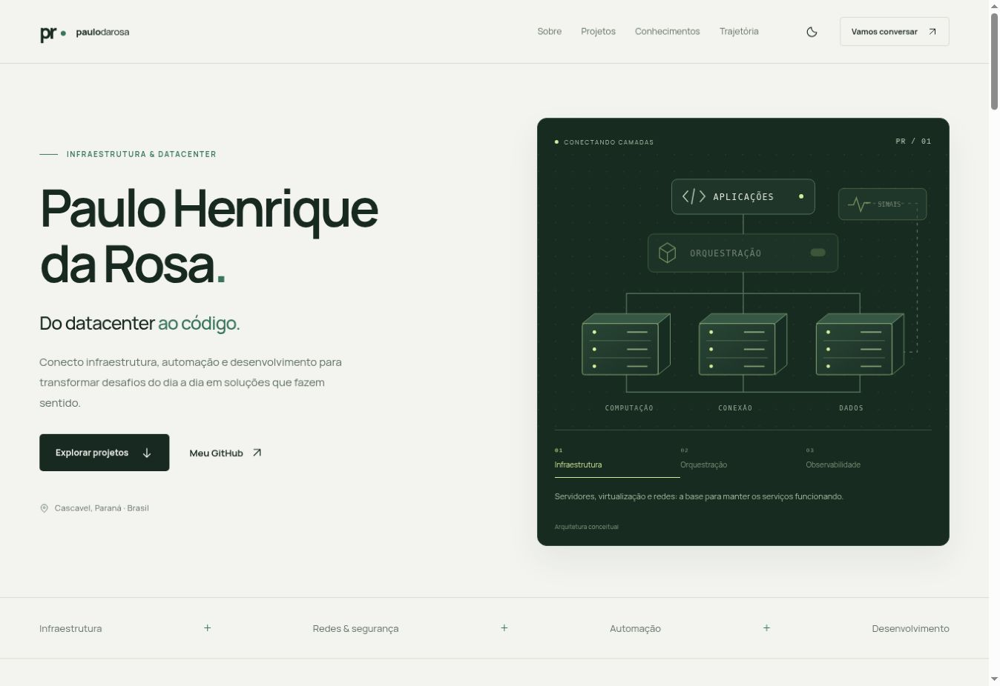
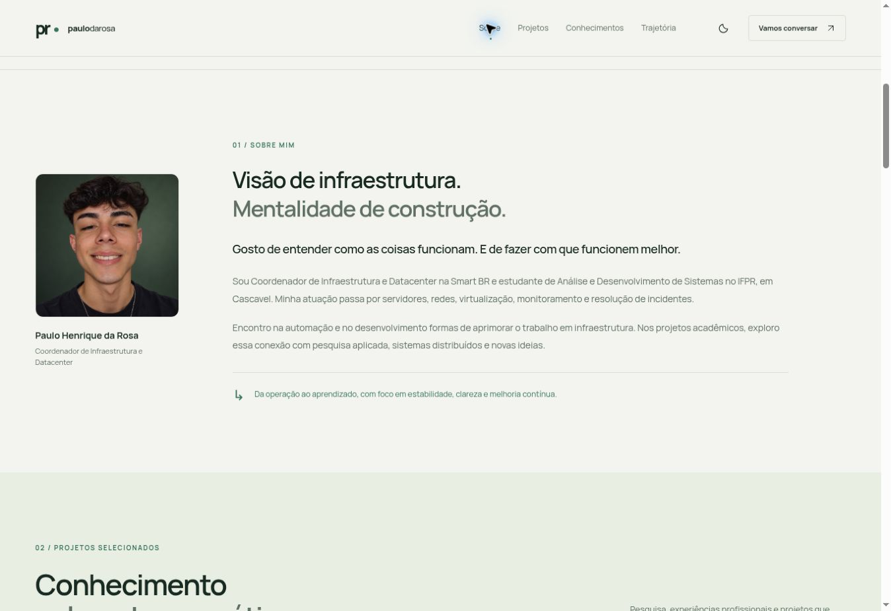

# Paulo Henrique da Rosa — Portfólio

Portfólio pessoal de Paulo Henrique da Rosa, com foco em infraestrutura e datacenter, conhecimentos técnicos, projetos e formação. Preparado para o domínio **paulodarosa.com** e para publicação no GitHub Pages.

O site usa **HTML, CSS e JavaScript puros**. Os arquivos finais ficam em `dist/`: não há instalação de pacotes, compilação, banco de dados ou servidor de aplicação.

## O que o site apresenta

- Apresentação profissional e áreas de atuação.
- Conhecimentos organizados por especialidade.
- Projetos com filtros, busca e detalhes em diálogos.
- Experiência, formação e iniciativas pessoais.
- Navegação adaptada a celulares e seletor de tema.
- Diagrama conceitual com seleção de camadas para explorar as áreas de conhecimento.
- Links para os perfis e repositórios públicos informados.

O conteúdo principal está no HTML. O JavaScript acrescenta as interações. O diagrama é uma representação conceitual do portfólio, sem representar uma rede corporativa real.





## Visualizar no computador

Com Python instalado, abra um terminal na pasta do projeto e execute:

```bash
python -m http.server 8000 --directory dist
```

No Windows, se o comando `python` não estiver disponível, use:

```powershell
py -m http.server 8000 --directory dist
```

Acesse [http://localhost:8000](http://localhost:8000). Para encerrar o servidor local, pressione `Ctrl+C` no terminal.

## Estrutura

| Arquivo ou diretório | Função |
| --- | --- |
| `dist/index.html` | Conteúdo, seções, cartões dos projetos e modelos dos diálogos. |
| `dist/styles.css` | Identidade visual, temas, espaçamentos e adaptações de tela. |
| `dist/app.js` | Filtros, busca, diálogos, menu móvel, tema e seleção das camadas do diagrama. |
| `dist/assets/` | Ícones, ilustrações SVG, fonte local, retrato e imagem de compartilhamento. |
| `dist/assets/paulo-portrait.png` | Retrato pessoal exibido na seção Sobre mim. |
| `dist/assets/social-preview.png` | Imagem usada na prévia de compartilhamento do site. |
| `dist/404.html` | Página de endereço não encontrado. |
| `dist/robots.txt` | Orientações para mecanismos de busca. |
| `dist/sitemap.xml` | Endereço canônico informado aos mecanismos de busca. |
| `dist/CNAME` | Registro do domínio desejado para compatibilidade com publicação por branch. O workflow Actions não usa este arquivo para configurar o domínio. |
| `.github/workflows/pages.yml` | Publicação automática de `dist/` no GitHub Pages. |
| `PUBLICACAO.md` | Guia para enviar ao GitHub, ativar Pages, configurar DNS e HTTPS. |

## Editar o portfólio

### Textos, links e projetos

Edite `dist/index.html`. Para adicionar um projeto, copie a estrutura de um cartão e de seu modelo de diálogo correspondente, mantenha identificadores únicos e ajuste a ligação entre o botão e os detalhes. Atualize também a categoria do cartão para que filtros e busca continuem coerentes.

Mantenha as descrições e os estados dos projetos atualizados. Inclua links somente quando existirem e puderem ser divulgados. Ao acrescentar um meio de contato, use um endereço ou perfil que você queira tornar público.

### Aparência

Edite `dist/styles.css`. As cores, os estilos dos componentes e as regras para diferentes larguras de tela ficam nesse arquivo. Depois de alterar o tema, confira a leitura de títulos, texto, botões e estados de foco nos dois modos.

### Comportamento

Edite `dist/app.js` para mudar filtros, busca, abertura dos detalhes, navegação móvel, preferência de tema ou diagrama. Preserve as associações entre os controles no HTML e os elementos utilizados pelo script.

### Imagens e endereço do site

Coloque os novos recursos em `dist/assets/` e ajuste os caminhos no HTML. Use nomes sem espaços e preserve letras maiúsculas e minúsculas nos caminhos.

O retrato da seção **Sobre mim** está em `dist/assets/paulo-portrait.png`. Para substituí-lo, salve a nova foto nesse mesmo caminho, mantendo o nome e o formato PNG. Prefira uma imagem quadrada com boa resolução e o rosto centralizado; o site adapta seu tamanho ao espaço disponível.

Se mudar o nome ou o formato do arquivo, atualize o atributo `src` da imagem dentro da seção `id="sobre"` em `dist/index.html`. Mantenha a descrição `alt` adequada ao retrato e os atributos `width` e `height` coerentes com as dimensões da imagem. A legenda e o cargo podem ser editados no `figcaption` da mesma seção. Após a troca, confira o enquadramento no computador e no celular.

Se trocar o domínio, atualize os metadados de `dist/index.html`, `dist/sitemap.xml`, `dist/robots.txt` e `dist/CNAME`, além das configurações do GitHub Pages e do DNS. O domínio no arquivo `CNAME`, sozinho, não configura uma publicação feita pelo Actions.

### Gerar um pacote para o GitHub

O pacote entregue já está preparado para `paulodarosa.com`. Para gerar outra cópia portável a partir deste projeto:

```bash
python scripts/export-github.py ../paulo-portfolio-github.zip --domain paulodarosa.com
```

O script ajusta os metadados para o domínio de destino, preserva `.github/workflows/pages.yml` e exclui histórico Git, arquivos temporários e configurações locais de hospedagem. A fonte Manrope e sua licença estão incluídas em `dist/assets/`.

## Publicar no GitHub

O nome recomendado para o repositório é **`paulodarosa7.github.io`**, se estiver disponível na conta correta. Esse nome oferece uma URL de usuário simples; outro nome de repositório também pode ser usado com o domínio personalizado.

O workflow publica apenas o conteúdo de `dist/`, a cada envio para a branch `main` ou por execução manual. Ative **Settings → Pages → Source → GitHub Actions** no repositório.

Consulte [PUBLICACAO.md](PUBLICACAO.md) para o procedimento completo e os registros de `paulodarosa.com`. Estes arquivos preparam a publicação; não comprovam que um repositório, domínio ou site já esteja configurado.

## Hospedagem e serverless

Para esta versão, o GitHub Pages atende à publicação de um portfólio estático em repositório público no GitHub Free. Não é necessário contratar uma VM ou manter um processo de backend. Consulte a [documentação de disponibilidade do GitHub Pages](https://docs.github.com/en/pages/getting-started-with-github-pages/github-pages-limits).

Um backend externo ou uma função serverless só passa a ser necessário quando houver uma função que precise executar no servidor, como processar um formulário, guardar dados ou acessar uma API com segredo. Até lá, mantenha o site estático e use os links de contato. Esta implementação não cria nem contrata serviços externos.

## Conferir antes de atualizar

Abra a versão local e verifique os links, os filtros e a busca, a abertura e o fechamento dos detalhes, o menu móvel e os temas. Confira o conteúdo em tela pequena e a navegação pelo teclado. Depois de publicar, veja o resultado do workflow na aba **Actions**.

As orientações específicas de hospedagem, domínio e HTTPS estão referenciadas no guia de publicação.
